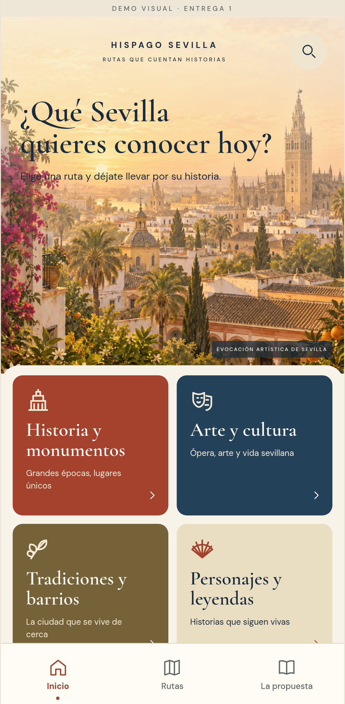
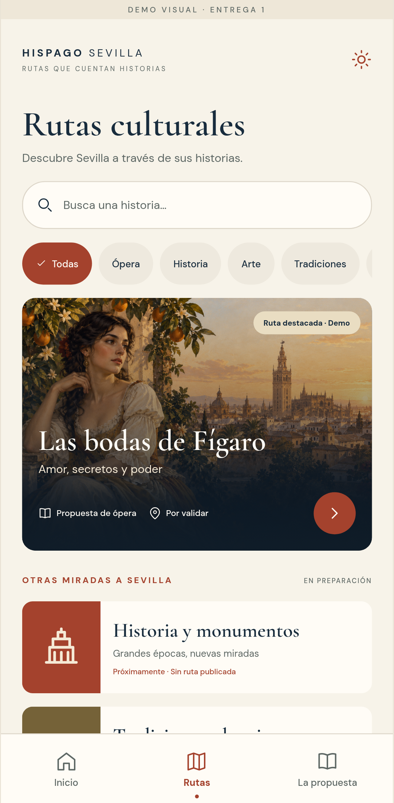
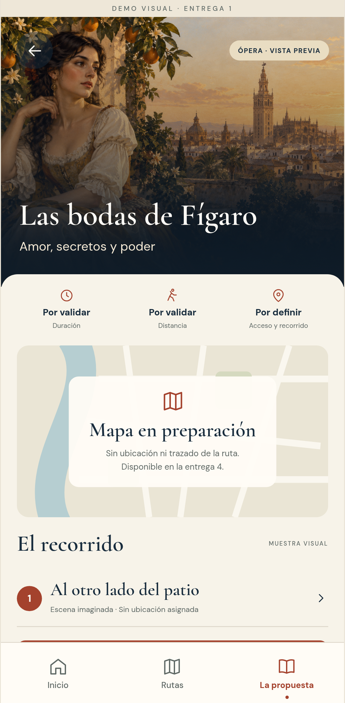

# Identidad visual · Sevilla, a tu paso

Revisión visual de la entrega 1 basada en la referencia de tres pantallas aportada
por Antonio. Pendiente de valoración final de Antonio y Ana.

La interfaz se inspira en cal, patios, cerámica, albero y rejería. La nueva
composición da protagonismo a ilustraciones de ambiente romántico, títulos
editoriales, tarjetas de categorías y una navegación inferior estable.
Las imágenes evocan Sevilla y la ópera; no describen localizaciones verificadas.

## Traducción de la referencia

- Inicio inmersivo con imagen de Sevilla, bienvenida y cuatro colecciones.
- Catálogo separado con buscador, categorías y portada destacada de Fígaro.
- Detalle con portada a sangre, panel práctico, espacio del mapa y parada demo.
- Barra inferior con destinos reales: Inicio, Rutas y La propuesta.
- Parada de muestra adaptada a la misma paleta y recursos de imagen.

Favoritos y Perfil no se han añadido a esta fase. Los valores turísticos de la
referencia no se copiaron: tiempos, distancias y acceso siguen por validar.
El mapa no es funcional y lo indica explícitamente; tampoco hay audio o progreso.

## Tokens

| Uso | Valor |
|---|---|
| Fondo de cal | `#F7F3E9` |
| Superficie | `#FFFCF6` |
| Azul oscuro / texto principal | `#182C3D` |
| Texto secundario | `#5E6865` |
| Terracota / acento y acciones | `#A4422D` |
| Oliva / categoría | `#756238` |
| Arena / categoría y etiquetas | `#E9DDC2` |
| Albero decorativo | `#D5A552` |
| Salvia / superficies | `#DDE4D6` |

El albero no se usa como texto informativo sobre fondo claro. Los valores de
contraste medidos y las comprobaciones de accesibilidad están en el reporte QA.

Títulos: Cormorant Garamond. Texto y controles: DM Sans. Los archivos se
empaquetan localmente y sus licencias se registran en el inventario de recursos.

Controles de al menos 44–48 puntos de alto, categorías seleccionadas con marca y
color, etiquetas accesibles, texto ampliable y adaptación a anchos de pantalla.
La prueba de lector de pantalla y texto grande en Android sigue pendiente.
Los filtros exponen `aria-pressed` y las pestañas `aria-selected` en web, además
del estado de accesibilidad nativo. Las portadas conservan una descripción
accesible; sus velos SVG son decorativos y no reciben foco.

## Pantallas de referencia

| Inicio | Rutas | Detalle |
|---|---|---|
| [](screenshots/inicio.png) | [](screenshots/explorar.png) | [](screenshots/detalle.png) |

- [Inicio](screenshots/inicio.png): bienvenida ilustrada y colecciones.
- [Rutas](screenshots/explorar.png): portada destacada, búsqueda y categorías locales.
- [Detalle](screenshots/detalle.png): presentación, datos pendientes y acceso a la parada demo.
- [Parada](screenshots/parada.png): relato ficticio, audio pendiente y ejemplo desplegable.

Las capturas proceden de Chromium con viewport móvil, no de un APK instalado.
La exportación web es una herramienta de revisión; el producto principal sigue
siendo Android.
Antes de capturar se espera a las fuentes y a las imágenes; la navegación web no
usa transiciones de pantalla, mientras Android conserva su animación nativa.

Para regenerarlas después de exportar web, desde `mobile` en Linux:

```sh
CAPTURE_DESIGN=1 npm run test:e2e
```

En PowerShell: `$env:CAPTURE_DESIGN='1'` y después `npm run test:e2e`.
